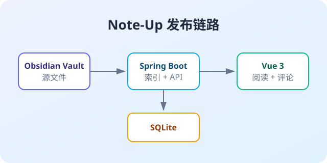

# Obsidian 方言指南

Obsidian 的 `.md` 是一套方言。项目采用**分层转换**：能标准化的在后端转换，复杂结构交给前端增强，插件运行时语法直接剥离。

## 双链

普通双链会变成站内链接，例如 [[欢迎]] 和 [[索引器设计#渲染流程|索引器渲染流程]]。不存在的笔记会降级为搜索链接：[[还不存在的笔记]]。

## 嵌入

- 图片嵌入：![[diagram.svg]]
- 带尺寸：![[diagram.svg|220]]
- 整篇笔记的嵌入一期降级为普通链接：![[欢迎]]

## Callout 变体

> [!warning] 注意
> 不要把私密笔记设置成 `publish: true`。

> [!example]+ 展开示例
> 一个默认展开的示例 Callout。

> [!quote]
> 源文件是唯一真相。

## 代码

```java
public record Note(long id, String slug, String title) {
    public boolean published() {
        return true;
    }
}
```

## 注释与块 ID

这里有一个 %%不会出现在网页上的注释%% 以及一个块引用标识。^dialect-block

## 标准 Markdown 图片



## DataviewJS 会被剥离

```dataviewjs
dv.table(["文件"], dv.pages('"笔记"').map(p => [p.file.link]))
```

#标签/多级 #另一枚标签