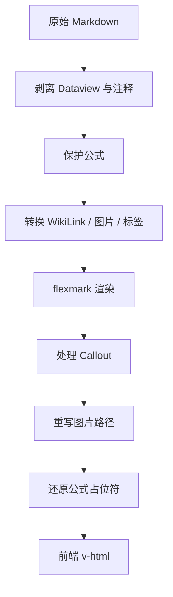

# Markdown 渲染管线

Markdown 只在后端渲染一次，前端直接展示 HTML。这样双链、标题锚点和反向链接都只有一套解析结果。

## 流程图



## 公式保护

块级公式必须在进入 Markdown 解析器之前替换成占位符，否则会被拆成多个段落，反斜杠也会被转义：

```java
if (stripped.startsWith("$$")) {
    // 捕获到闭合的 $$ 后整体替换为 NOTEUMATHPLACEHOLDER
}
```

## 前端增强

```js
const mermaid = (await import('mermaid')).default
const hljs = (await import('highlight.js/lib/common')).default
const renderMath = (await import('katex/contrib/auto-render')).default
```

> [!warning] 不要前后端各解析一次
> 如果前端再解析一遍 Markdown，双链与标题锚点会和后端结果不一致，反向链接也会错位。

相关笔记：[[Obsidian方言指南]]、[[索引器设计]]、[[数学公式示例]]。

#渲染 #前端