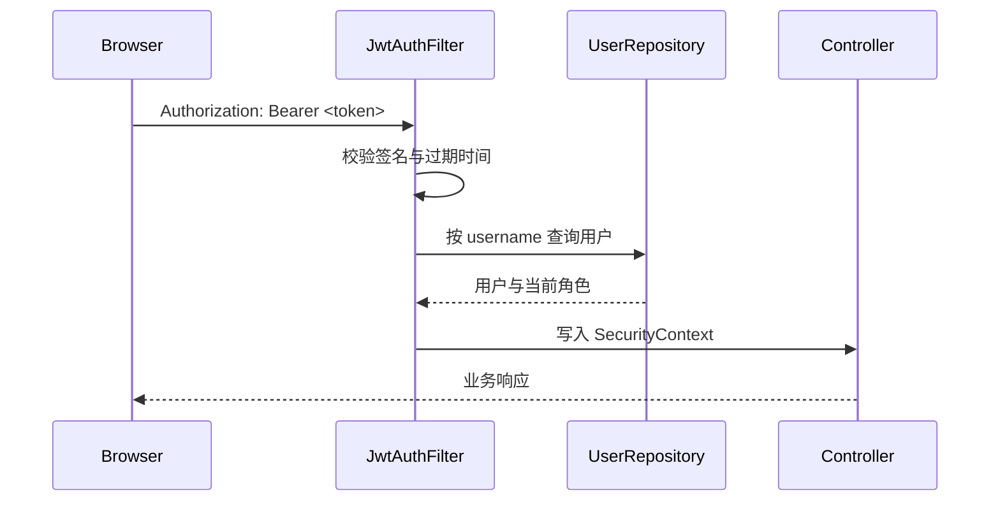

# Spring Security 与 JWT

本站使用 Spring Security 做授权，JWT 做无状态认证。服务端不保存会话，所有请求通过 `Authorization: Bearer` 识别用户。

## 过滤器链



> [!important] 角色以数据库为准
> Token 里虽然带有 `role`，但过滤器每次都会重新查库。管理员改角色或禁用账号后立即生效，不必等 token 过期。

## 关键代码

```java
Jws<Claims> jws = Jwts.parser()
        .verifyWith(key)
        .build()
        .parseSignedClaims(token);

String username = jws.getPayload().getSubject();
```

## 权限矩阵

| 路径 | 游客 | 登录用户 | 管理员 |
|---|---|---|---|
| `GET /api/notes/**` | 允许 | 允许 | 允许 |
| `POST /api/comments` | 拒绝 | 允许 | 允许 |
| `GET /api/admin/**` | 拒绝 | 拒绝 | 允许 |
| `POST /api/hooks/reindex` | Token 校验 | Token 校验 | Token 校验 |

## 安全检查

- [x] 注册接口固定写入 `GUEST`
- [x] 密码使用 BCrypt
- [x] 禁用用户无法继续使用旧 token
- [x] 管理接口要求 `ROLE_ADMIN`
- [ ] 生产环境替换默认 `JWT_SECRET`

相关实现见 [[索引器设计]]，上线前检查 [[部署清单]]。行内标签 #认证 #安全。