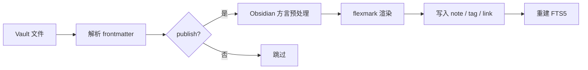

# 索引器设计

索引器全量扫描 Vault，解析 frontmatter，渲染 Markdown，最后写入 SQLite。千篇以内不需要增量索引。

## 渲染流程

## 为什么全量重建

- 源文件是唯一真相，数据库随时可丢弃。
- 100 篇规模下全量扫描只需毫秒级。
- 幂等：重复执行结果一致。

## 双链解析

先扫描所有文件建立「标题 / 文件名 / 别名 → slug」映射，再渲染正文，所以前向链接也能正确生成。反向链接通过 `link` 表查询。

参见 [[欢迎]]、[[Obsidian方言指南#双链]]。

## 复杂度

设笔记数为 $n$，链接数为 $m$，全量索引复杂度约为 $O(n + m)$。

> [!info] FTS5
> 搜索使用 SQLite FTS5 虚拟表，中文查询会按短语匹配。

## 待办

- [x] frontmatter 解析
- [x] WikiLink
- [x] Callout
- [ ] 增量索引（暂不需要）