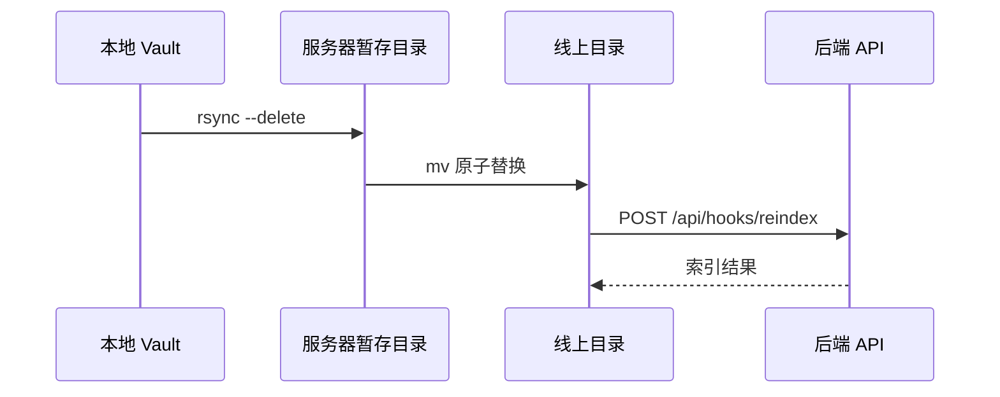

# rsync 同步与原子替换

直接对线上目录执行 `rsync --delete` 有风险：同步过程中后端可能读到半新半旧的状态。推荐先同步到暂存目录，再整体替换。

## 同步流程



## 核心命令

```bash
rsync -az --delete \
  --exclude='.obsidian/' \
  --exclude='.trash/' \
  --exclude='.git/' \
  ~/vault/ user@server:/srv/vault-staging/

ssh user@server "set -euo pipefail
  rm -rf /srv/vault.old
  if [ -e /srv/vault ]; then mv /srv/vault /srv/vault.old; fi
  mv /srv/vault-staging /srv/vault
  rm -rf /srv/vault.old
  curl -sf -X POST http://localhost:8080/api/hooks/reindex \
    -H 'X-Hook-Token: $HOOK_TOKEN'
"
```

## 常用参数

| 参数 | 作用 |
|---|---|
| `-a` | 归档模式，保留权限与时间 |
| `-z` | 传输时压缩 |
| `--delete` | 删除目标端多余文件 |
| `--exclude` | 排除 Obsidian 配置和回收站 |
| `--dry-run` | 先演练，不实际写入 |

> [!caution] `--delete` 与软删
> 源文件被删除后，索引器会把笔记标记为软删，评论仍然保留。这样误删恢复后不会丢评论。

同步完成后由 [[部署清单]] 检查服务状态，索引细节见 [[索引器设计]]。 #rsync #运维