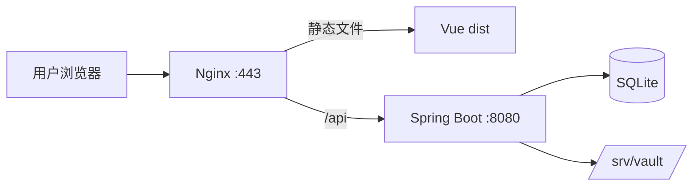

# 上线部署清单

正式开放前，按这份清单逐项确认。任何一项缺失都可能导致数据泄露或服务不可用。

## 必须完成

- [x] 后端 jar 与前端 `dist` 已构建
- [x] Nginx 配置 `/api` 反向代理与 SPA fallback
- [ ] 配置 Let's Encrypt 证书并强制 HTTPS
- [ ] 替换 `JWT_SECRET`、`ADMIN_PASSWORD`、`HOOK_TOKEN`
- [ ] `CORS_ORIGINS` 只保留正式域名
- [ ] Vault 与数据库每日备份
- [ ] 用普通用户运行后端，不使用 root

## 服务拓扑

## 环境变量

| 变量 | 生产建议 |
|---|---|
| `VAULT_ROOT` | `/srv/vault` |
| `DB_PATH` | `/opt/note-up/backend/data/notes.db` |
| `JWT_SECRET` | 至少 32 字节随机串 |
| `ADMIN_PASSWORD` | 首次启动后立即修改 |
| `HOOK_TOKEN` | 随机串，仅同步脚本持有 |
| `INDEX_ON_STARTUP` | `true` |

> [!danger] 不要暴露数据库目录
> `DB_PATH` 必须放在 Nginx 静态目录之外。SQLite 文件一旦可下载，所有待审核评论和用户密码哈希都会泄露。

> [!tip] 备份要同时包含 Vault 与 DB
> 笔记丢失是灾难级问题。数据库可以重建，但 Vault 不能。备份脚本见 [[rsync 同步与原子替换]] 一文末尾的思路。

部署完成后回到 [[项目计划]] 核对阶段目标，搜索性能参考 [[SQLite 与 FTS5]]。 #运维 #部署